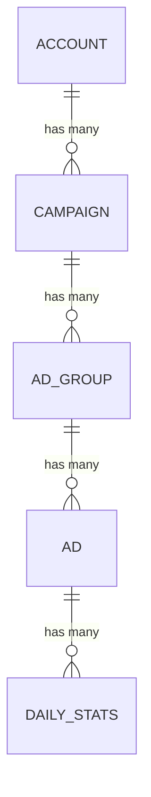

# Objective:
The objective of this document is to build a reuseable analytical product as a dat model for a marketing company. 

## Data profiling findings

**Facebook (2025 data)**
- Stats: 92,300 rows, one row per ad per day; (ad_id, ad_date) is unique.
- Stats have no campaign_id; the ads table links each ad to its ad group, campaign and account.
- Currency is on the account, not the stats row. 66,212 stats rows belong to USD accounts, the rest EUR.
- Impressions and clicks are stored as text, with the literal value 'null'
  (1,474 null impressions, 24,337 null clicks). Spend has no nulls.
- Null clicks occur mostly on low-impression rows, and explicit zeros are rare (42),
  suggesting null usually means no activity.

**Snapchat (2024 data)**
- Stats: 2,809 rows, one row per ad per day per country; (ad_detail_id, ad_date, ad_country) is unique.
- ad_detail_id matches the ad_id in the Snapchat ads table.
- All spend is in EUR. 111 null clicks.
- The ad group table has 3 ad groups with two history rows each.

**Cross-platform**
- The two platforms cover different years (Snapchat 2024, Facebook 2025),
  so a like-for-like comparison over the same period is not possible with this data.
- Country in campaign names (intended market) is not the same as Snapchat's
  ad_country (where the ad was shown), so they should not share a column.

## How the advertising data is organised

Both platforms organise advertising the same way: each level contains many of the level below.

- **Account**: the company's ad account on the platform (holds the currency on Facebook)
- **Campaign**: a marketing goal, e.g. a back-to-school sign-up push
- **Ad group**: who sees the ad (audience, placement, budget)
- **Ad**: the creative itself (image, video, text)
- **Daily stats**: spend, impressions and clicks, recorded per ad per day
  (and per country on Snapchat)

## Assumptions and limitations

- **Nulls:** Null impressions and clicks are treated as 0. For a small
  number of high-impression rows this is an assumption.
  See [decisions.md](decisions.md).
- **No country:** The unified model does not include country. Snapchat's
  country detail is available in its staging model. See [decisions.md](decisions.md).
- **Different years:** The Facebook data covers 2025 and the Snapchat data covers 2024. They do not overlap, so differences between platforms may reflect changes over time (seasonality, budgets, market conditions) rather than platform performance. Compare platforms using rates (CTR, CPC, CPM) rather than totals, and state the years whenever presenting a comparison.

# Loading the Data
## Raw data sources

The source files were loaded unchanged into the `cam_raw_bronze` catalog,
with one schema per source system. Table names were shortened from the
original file names, which described how the files were prepared rather
than what they contain.

| Platform | Raw table | Original file | Contents |
|---|---|---|---|
| Facebook | `cam_raw_bronze.facebook.ads_stats` | `ads_stats.csv` | Daily spend, impressions and clicks per ad |
| Facebook | `cam_raw_bronze.facebook.ads` | `new_ads_de_randomized.csv` | Ads, with their ad group, campaign and account |
| Facebook | `cam_raw_bronze.facebook.ad_groups` | `new_adgroup_de_randomized.csv` | Ad group names |
| Facebook | `cam_raw_bronze.facebook.campaigns` | `new_campaign_de_randomized.csv` | Campaign names |
| Facebook | `cam_raw_bronze.facebook.accounts` | `new_acccount_de_randomized.csv` | Account names and currency |
| Snapchat | `cam_raw_bronze.snapchat.ads_stats` | `snapchat_ads_stats.csv` | Daily spend, impressions and clicks per ad and country |
| Snapchat | `cam_raw_bronze.snapchat.ads` | `snapchat_ads_ad_history_new_ad_names.csv` | Ads, with their ad group |
| Snapchat | `cam_raw_bronze.snapchat.ad_groups` | `snapchat_ads_adgroup_history_new_ad_group_names.csv` | Ad groups, with their campaign (includes history rows) |
| Snapchat | `cam_raw_bronze.snapchat.campaigns` | `snapchat_ads_campaign_history_new_campaign_names.csv` | Campaigns, with their account |

**How the data was loaded:** The Snapchat CSV files were uploaded through the Databricks
"Create or modify table" screen, with all columns stored as text so that
values are kept exactly as received. Types are converted in the dbt
staging models. Facebook files were loaded with SQL, after uploading the files to a volume,with all columns stored as text so values are kept exactly as received.

# Findings and Learnings
## Learnings:
- The id column datatype should be a string(text or alphanumerals) because using a number for the ID and loading it into excel, one might make a mistake and perform compute operations on them, and if the data uniqueness difference is in the middle of the ID, excel could round them off as numeric numvers and they lose their unique identity once the file is saved. 

