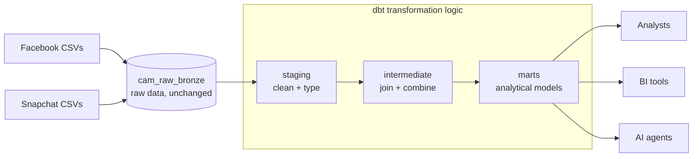
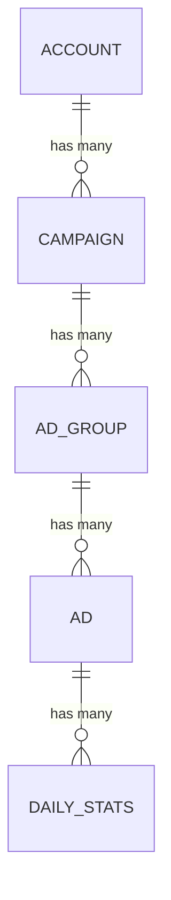
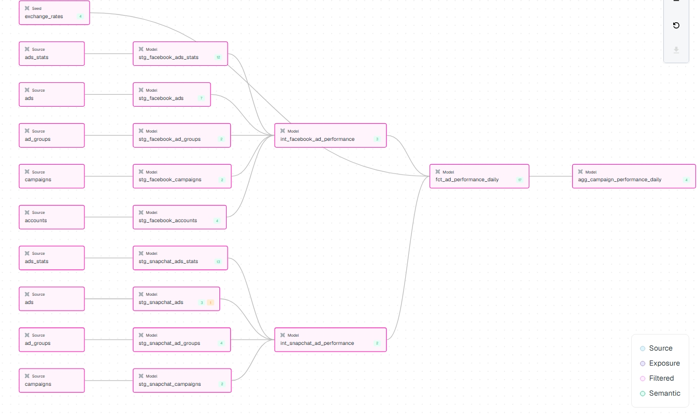
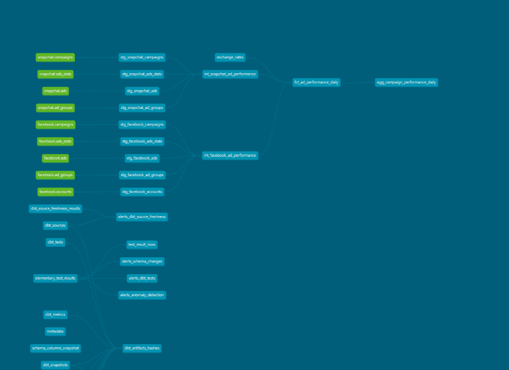
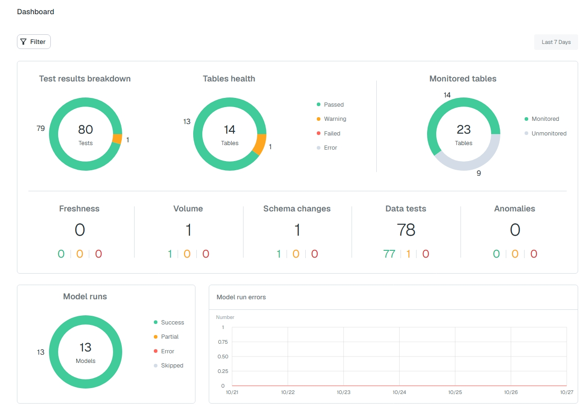

# Marketing Data Platform: Facebook & Snapchat Ads on Databricks + dbt

A production-minded data product that turns raw Facebook Ads and Snapchat Ads
exports into one trusted, documented and tested model of advertising
performance, ready for analysts, BI tools and AI agents.

## Lineage Graph


## Architecture



| Layer | Where | Medallion | Purpose |
|---|---|---|---|
| Raw data | `cam_raw_bronze` catalog | Bronze | Source files loaded unchanged. dbt reads it but never writes to it |
| Transformation logic | `models/staging`, `models/intermediate` | Silver | Clean, type, deduplicate, join and combine the platforms |
| Analytical models | `models/marts` | Gold | `fct_ad_performance_daily`, `agg_campaign_performance_daily` |
| Consumption layer | `cam_prod.marts` | Gold | What analysts, BI tools and agents query |

The raw catalog is named after a layer because it is shared: every
environment reads the same raw data. The other catalogs are named after
environments, because each environment has its own silver and gold copies.

## How the advertising data is organised

Both platforms organise advertising the same way: each level contains many of
the level below.



- **Account**: the company's ad account (holds the currency on Facebook)
- **Campaign**: a marketing goal
- **Ad group**: who sees the ad (audience, placement, budget)
- **Ad**: the creative itself
- **Daily stats**: spend, impressions and clicks per ad per day (and per country on Snapchat)

The stats only know the ad, so models climb the tree
(ad → ad group → campaign → account) to attach names.

## Raw data sources

| Platform | Raw table | Original file | Contents |
|---|---|---|---|
| Facebook | `cam_raw_bronze.facebook.ads_stats` | `ads_stats.csv` | Daily spend, impressions and clicks per ad |
| Facebook | `cam_raw_bronze.facebook.ads` | `new_ads_de_randomized.csv` | Ads, with their ad group, campaign and account |
| Facebook | `cam_raw_bronze.facebook.ad_groups` | `new_adgroup_de_randomized.csv` | Ad group names |
| Facebook | `cam_raw_bronze.facebook.campaigns` | `new_campaign_de_randomized.csv` | Campaign names |
| Facebook | `cam_raw_bronze.facebook.accounts` | `new_acccount_de_randomized.csv` | Account names and currency |
| Snapchat | `cam_raw_bronze.snapchat.ads_stats` | `snapchat_ads_stats.csv` | Daily spend, impressions and clicks per ad and country |
| Snapchat | `cam_raw_bronze.snapchat.ads` | `snapchat_ads_ad_history_new_ad_names.csv` | Ads, with their ad group |
| Snapchat | `cam_raw_bronze.snapchat.ad_groups` | `snapchat_ads_adgroup_history_new_ad_group_names.csv` | Ad groups, with their campaign (includes history rows) |
| Snapchat | `cam_raw_bronze.snapchat.campaigns` | `snapchat_ads_campaign_history_new_campaign_names.csv` | Campaigns, with their account |

**How the data was loaded:** Facebook files were loaded with SQL, with all
columns stored as text so values are kept exactly as received. Snapchat files
were loaded through the Databricks upload screen. Column types are converted
in the dbt staging models. See `setup/03_load_raw_data.sql`.

## Data profiling findings

**Facebook (2025 data)**
- Stats: 92,300 rows, one row per ad per day; (ad_id, ad_date) is unique.
- Stats have no campaign_id; the ads table links each ad to its ad group, campaign and account.
- Currency is on the account, not the stats row. 66,212 stats rows belong to USD accounts, the rest EUR.
- Impressions and clicks are stored as text with the literal value 'null'
  (1,474 null impressions, 24,337 null clicks). Spend has no nulls.
- Null clicks occur mostly on low-impression rows, and explicit zeros are rare (42),
  suggesting null usually means no activity.

**Snapchat (2024 data)**
- Stats: 2,809 rows, one row per ad per day per country; (ad_detail_id, ad_date, ad_country) is unique.
- ad_detail_id matches the ad_id in the Snapchat ads table.
- All spend is in EUR. 111 null clicks.
- The ad group table has 3 ad groups with two history rows each.

**Cross-platform**
- The platforms cover different years (Snapchat 2024, Facebook 2025).
- Country in campaign names (intended market) is not the same as Snapchat's
  ad_country (where the ad was shown), so they should not share a column.

## Data model

```
staging (views)                     intermediate (views)              marts (tables)
stg_facebook_ads_stats  ─┐
stg_facebook_ads        ─┼─> int_facebook_ad_performance ─┐
stg_facebook_ad_groups  ─┤                                 ├─> fct_ad_performance_daily ─> agg_campaign_performance_daily
stg_facebook_campaigns  ─┤                                 │        ▲
stg_facebook_accounts   ─┘                                 │        │ exchange_rates (seed)
stg_snapchat_ads_stats  ─┐                                 │
stg_snapchat_ads        ─┼─> int_snapchat_ad_performance ─┘
stg_snapchat_ad_groups  ─┤
stg_snapchat_campaigns  ─┘
```

### Grain

| Model | One row is |
|---|---|
| `stg_facebook_ads_stats` | one ad on one day |
| `stg_snapchat_ads_stats` | one ad on one day in one country |
| `int_*_ad_performance` | one ad on one day |
| `fct_ad_performance_daily` | one ad on one day on one platform |
| `agg_campaign_performance_daily` | one campaign on one day on one platform |

### Keys

- Natural keys from the platforms (`ad_id`, `campaign_id`...) are kept as text.
- `fct_ad_performance_daily.ad_performance_id` is a surrogate key: a hash of
  platform, ad_id and ad_date. Platform is included because IDs are only
  unique within one platform.

### Facts and dimensions

The final design is a **wide fact table** (`fct_ad_performance_daily`) that
already carries the account, campaign, ad group and ad names, plus a
**campaign aggregate** (`agg_campaign_performance_daily`). Separate dimension
tables were not built because each platform's hierarchy is small, the
descriptive attributes are just names, and every business question in the
brief can be answered from one table without joins, which is simpler for
analysts, BI tools and AI agents. Dimensions could be split out later if
attributes grow.

### Business definitions

| Metric | Definition | When the denominator is 0 |
|---|---|---|
| Spend | `spend_eur`, converted with the ECB annual average rate | n/a |
| CTR | clicks / impressions | NULL |
| CPC | spend_eur / clicks | NULL |
| CPM | spend_eur / impressions × 1,000 | NULL |

Rates must be calculated from totals: sum spend, impressions and clicks, then
divide. Averaging row-level rates gives the wrong answer.
`agg_campaign_performance_daily` and `analyses/business_questions.sql` do this
correctly.

### Naming conventions

| Prefix | Layer | Example |
|---|---|---|
| `stg_<source>_<table>` | staging | `stg_facebook_ads_stats` |
| `int_<source>_<purpose>` | intermediate | `int_facebook_ad_performance` |
| `fct_` | fact table (marts) | `fct_ad_performance_daily` |
| `agg_` | aggregated model (marts) | `agg_campaign_performance_daily` |

Columns use snake_case; booleans start with `is_`; money columns end in their
currency (`spend_eur`).

### Materializations

| Layer | Materialization | Why |
|---|---|---|
| Staging | view | Light clean-up only; always reflects the latest raw data; no storage |
| Intermediate | view | Joins read only by the marts |
| `fct_ad_performance_daily` | incremental (merge) | After the first build, only the last 3 days per platform are reprocessed, so daily runs stay cheap as history grows |
| `agg_campaign_performance_daily` | table | Small; rebuilt in full from the fact table so the two always agree |

## Environments

| | Development | CI | Production |
|---|---|---|---|
| Runs | on my laptop | GitHub Actions, on every pull request | GitHub Actions, after merge to `main` |
| dbt target | `dev` | `ci` | `prod` |
| Catalog | `cam_dev` | `cam_ci` | `cam_prod` |
| Schemas | `dbt_josephine_<layer>` | `dbt_ci_pr_<number>_<layer>` | `<layer>` |
| Credentials | personal access token (`.env`) | personal access token (GitHub secret) | **service principal** (OAuth, GitHub secrets) |

`DBT_TARGET` selects the environment and defaults to `dev`, so forgetting to
set it can never write to production. Production authenticates as a service
principal so it does not depend on any one person's account.

Permissions follow least privilege (`setup/05_grants.sql`): the service
principal can only read the raw catalog and can only write to `cam_prod`.

## CI/CD

```
feature branch -> pull request -> CI (dbt build + tests in cam_ci) -> review -> merge -> production run (service principal)
```

- `.github/workflows/ci.yml` builds and tests every pull request in its own schema.
- `.github/workflows/deploy_prod.yml` builds production after each merge and saves the docs site.

GitHub secrets required: `DATABRICKS_HOST`, `DATABRICKS_HTTP_PATH`,
`DATABRICKS_CI_TOKEN`, `DATABRICKS_CLIENT_ID`, `DATABRICKS_CLIENT_SECRET`.

## Data quality and governance

- **Tests** (`dbt build` runs them): uniqueness of every grain, not-null keys,
  relationships between levels of the hierarchy, accepted values, and
  non-negative spend, impressions and clicks.
- **Monitoring**: Elementary records every test result and adds volume and
  schema-change monitoring on the fact table. Generate the report with
  `edr report` (see below).
- **Documentation**: every model and key column is described in YAML, and
  descriptions are copied into Unity Catalog for the marts.
- **Lineage**: all models use `source()` and `ref()`, so dbt draws the full
  lineage graph (`dbt docs serve`).

## Running the project

```bash
cd cam_marketing
source .env                  # loads Databricks credentials for dev
uv run dbt deps              # installs dbt_utils and elementary
uv run dbt build             # seeds, models and tests
uv run dbt docs generate && uv run dbt docs serve   # documentation and lineage
```

Elementary report (optional):

```bash
uv add "elementary-data[databricks]"
uv run edr report
```

## Assumptions and limitations

- **Nulls:** null impressions and clicks are treated as 0, flagged with
  `is_*_reported`. For a few high-impression rows this is an assumption.
- **No country:** the unified model does not include country. Snapchat's
  country detail is in `stg_snapchat_ads_stats`.
- **Different time periods:** Facebook covers 2025 and Snapchat 2024. They do
  not overlap, so platform differences may reflect changes over time rather
  than platform performance. Compare rates, not totals, and state the years.
- **Currency:** USD spend is converted with one annual average rate, not daily
  rates.
- **Ad group history:** only the latest version of each Snapchat ad group is
  kept, so reports show current names. dbt snapshots would be the way to keep
  full history.
- **Snapchat accounts:** no account table was provided, so `account_name` is NULL.
- **Missing Snapchat ad groups:** 304 ads (85 ad groups) reference ad groups
  missing from the source export. None of these ads have performance data, so
  no spend, impressions or clicks are affected. The relationships test reports
  this as a warning.

## Learnings

### IDs are stored as text, not numbers

- **IDs are labels, not quantities.** Nobody adds or averages an ID.
- **Long numeric IDs get corrupted by common tools.** Facebook IDs are up to
  18 digits. Excel keeps only 15 digits and silently replaces the rest with
  zeros, so different IDs can become identical. Many BI tools have a similar
  limit (about 16 digits).
- **The platforms use different ID formats.** Snapchat IDs are UUIDs, so a
  combined `ad_id` column must be text anyway.

See [decisions.md](decisions.md) for the reasoning behind each design choice.

## Screenshots

### Lineage graph (dbt docs)

From the raw sources, through staging and intermediate, to the marts.




### Data quality monitoring (Elementary)

Test results from the dbt runs, including the known warning for Snapchat ads
whose ad groups are missing from the source export.



## Use of AI assistance

This project was built with the help of Claude, 
used as a tutor and pair programmer. It explained concepts, reviewed my
reasoning, profiled the source data, helped debug errors, and drafted parts of
the SQL models, YAML configuration, CI/CD workflows and documentation.

The design decisions are my own. I made each choice in [decisions.md](decisions.md)
(for example the ad × day grain, treating nulls as zero, excluding country,
the raw catalog layout, and the environment design) after working through the
reasoning and trade-offs. 
